<div align="center">

<picture>
  <source media="(prefers-color-scheme: dark)" srcset="assets/brand/wordmark-on-dark.svg">
  
</picture>

<h1>Redbelly Explained</h1>

<p><b>Redbelly, made simple.</b><br>
An 11-part visual explainer series on the core ideas behind Redbelly Network,<br>
from DBFT consensus to Project Acacia, in plain language.</p>

<p>
  
  
  
  
  
</p>

<p>
  <a href="#the-series">The series</a> ·
  <a href="#formats">Formats</a> ·
  <a href="#view-it-locally">View it locally</a> ·
  <a href="#edit-and-re-export">Edit and re-export</a> ·
  <a href="SOURCES.md">Sources</a>
</p>

<br>

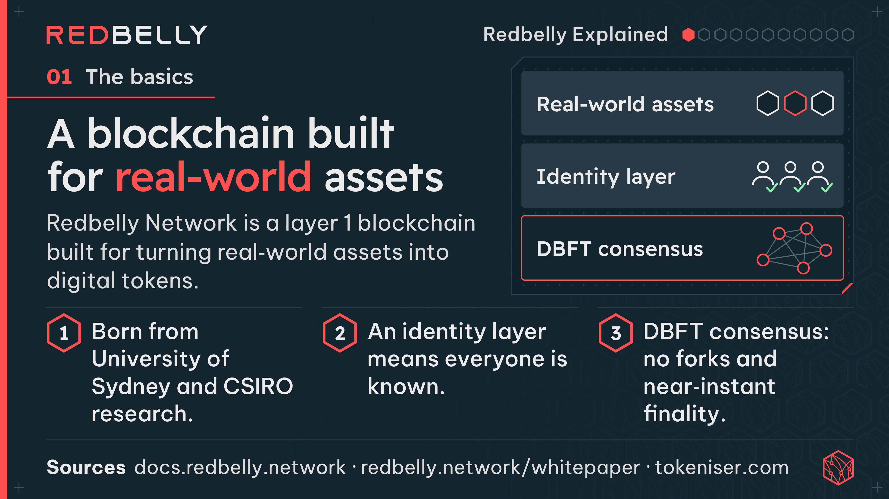

</div>

<br>

## About

New to Redbelly? Start here. Each image explains one core idea in under a minute. The series comes as 33 ready-to-post PNGs, a showcase website with live animated plates, and the editable source behind both.

<table>
  <tr>
    <td width="33%" valign="top">
      <b>One idea per image</b><br><br>
      Each plate carries a single concept: a headline, one sentence of context, one diagram and three short facts. Text is sized to be read on a phone without zooming.
    </td>
    <td width="33%" valign="top">
      <b>Every fact sourced</b><br><br>
      Every line traces to Redbelly's website, whitepaper, research hub and docs, Tokeniser, the Project Acacia deep dive, the TASK-23 changelog and the DAO voting platform.
    </td>
    <td width="33%" valign="top">
      <b>Brand kit only</b><br><br>
      The wordmark and isotype are taken as vectors from the Redbelly brand guidelines. Colours come from the guideline palette. Diagrams are drawn by hand for this series.
    </td>
  </tr>
</table>

## The series

Click any image to open it at full size. The links under each title go to every format.

<table>
  <tr>
    <td width="33%" valign="top">
      <a href="png/01-what-is-redbelly_1x1.png">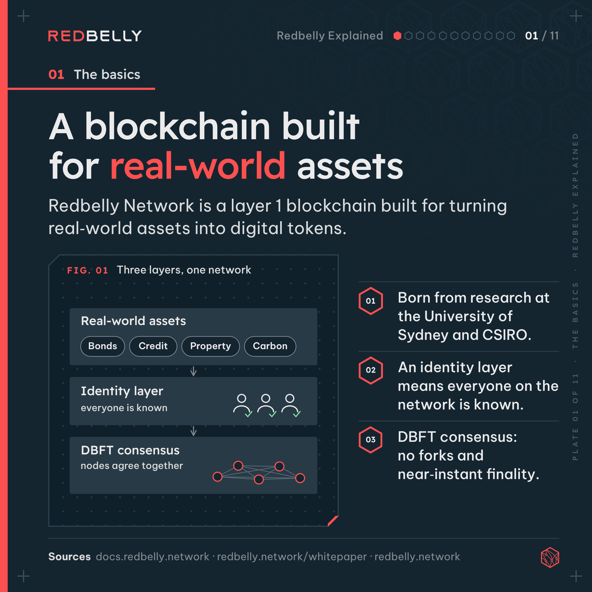</a><br>
      <sub><b>01</b> · THE BASICS</sub><br>
      <b>A blockchain built for real-world assets</b><br>
      <sub><a href="png/01-what-is-redbelly_16x9.png">16:9</a> · <a href="png/01-what-is-redbelly_4x5.png">4:5</a> · <a href="png/01-what-is-redbelly_1x1.png">1:1</a></sub>
    </td>
    <td width="33%" valign="top">
      <a href="png/02-why-tokenise_1x1.png">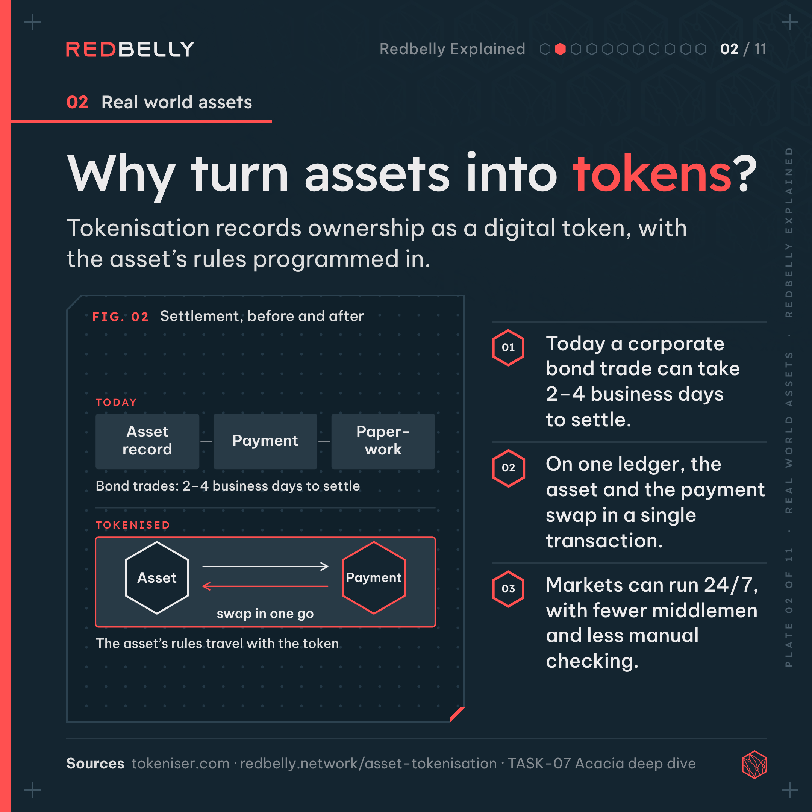</a><br>
      <sub><b>02</b> · REAL WORLD ASSETS</sub><br>
      <b>Why turn assets into tokens?</b><br>
      <sub><a href="png/02-why-tokenise_16x9.png">16:9</a> · <a href="png/02-why-tokenise_4x5.png">4:5</a> · <a href="png/02-why-tokenise_1x1.png">1:1</a></sub>
    </td>
    <td width="33%" valign="top">
      <a href="png/03-dbft-consensus_1x1.png">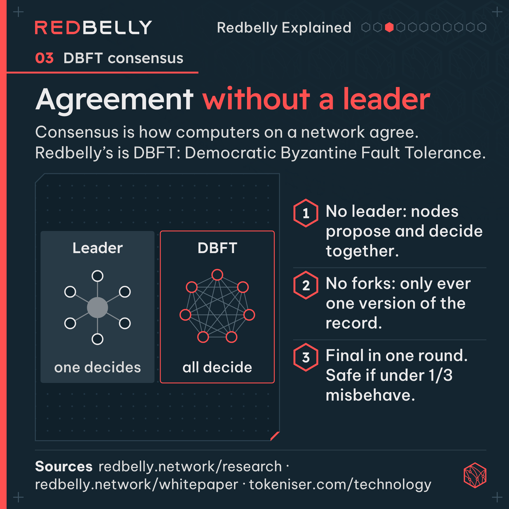</a><br>
      <sub><b>03</b> · DBFT CONSENSUS</sub><br>
      <b>Agreement without a leader</b><br>
      <sub><a href="png/03-dbft-consensus_16x9.png">16:9</a> · <a href="png/03-dbft-consensus_4x5.png">4:5</a> · <a href="png/03-dbft-consensus_1x1.png">1:1</a></sub>
    </td>
  </tr>
  <tr>
    <td width="33%" valign="top">
      <a href="png/04-receptor_1x1.png">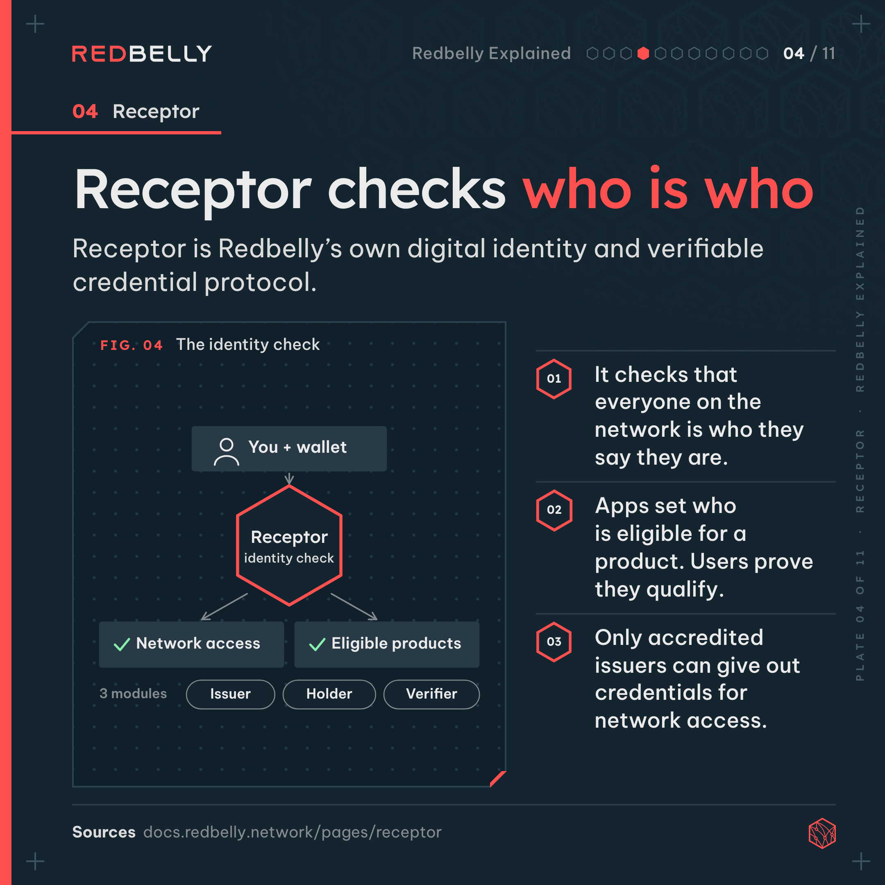</a><br>
      <sub><b>04</b> · RECEPTOR</sub><br>
      <b>Receptor checks who is who</b><br>
      <sub><a href="png/04-receptor_16x9.png">16:9</a> · <a href="png/04-receptor_4x5.png">4:5</a> · <a href="png/04-receptor_1x1.png">1:1</a></sub>
    </td>
    <td width="33%" valign="top">
      <a href="png/05-verifiable-credentials_1x1.png">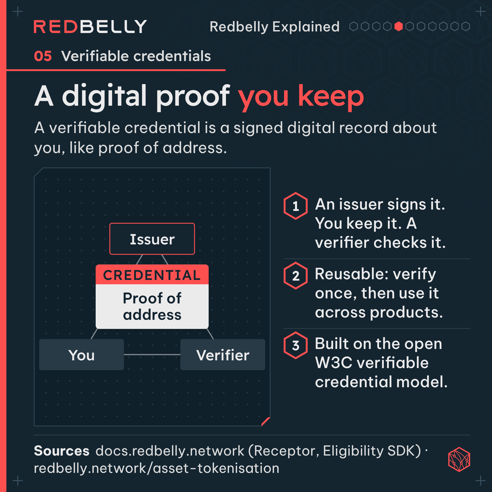</a><br>
      <sub><b>05</b> · VERIFIABLE CREDENTIALS</sub><br>
      <b>A digital proof you keep</b><br>
      <sub><a href="png/05-verifiable-credentials_16x9.png">16:9</a> · <a href="png/05-verifiable-credentials_4x5.png">4:5</a> · <a href="png/05-verifiable-credentials_1x1.png">1:1</a></sub>
    </td>
    <td width="33%" valign="top">
      <a href="png/06-zk-proofs_1x1.png">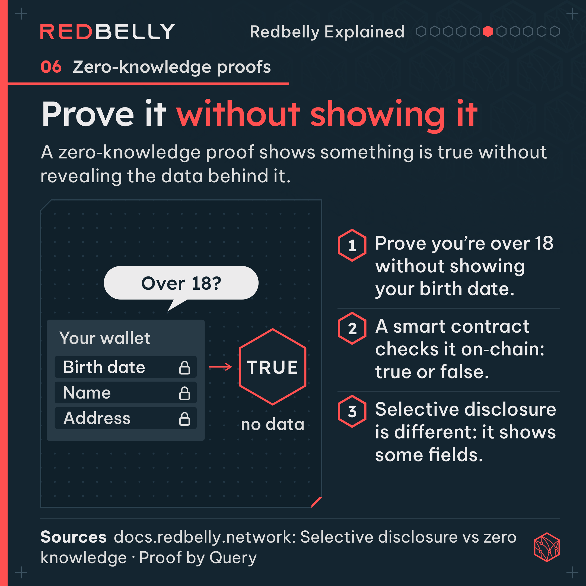</a><br>
      <sub><b>06</b> · ZERO-KNOWLEDGE PROOFS</sub><br>
      <b>Prove it without showing it</b><br>
      <sub><a href="png/06-zk-proofs_16x9.png">16:9</a> · <a href="png/06-zk-proofs_4x5.png">4:5</a> · <a href="png/06-zk-proofs_1x1.png">1:1</a></sub>
    </td>
  </tr>
  <tr>
    <td width="33%" valign="top">
      <a href="png/07-tokeniser_1x1.png">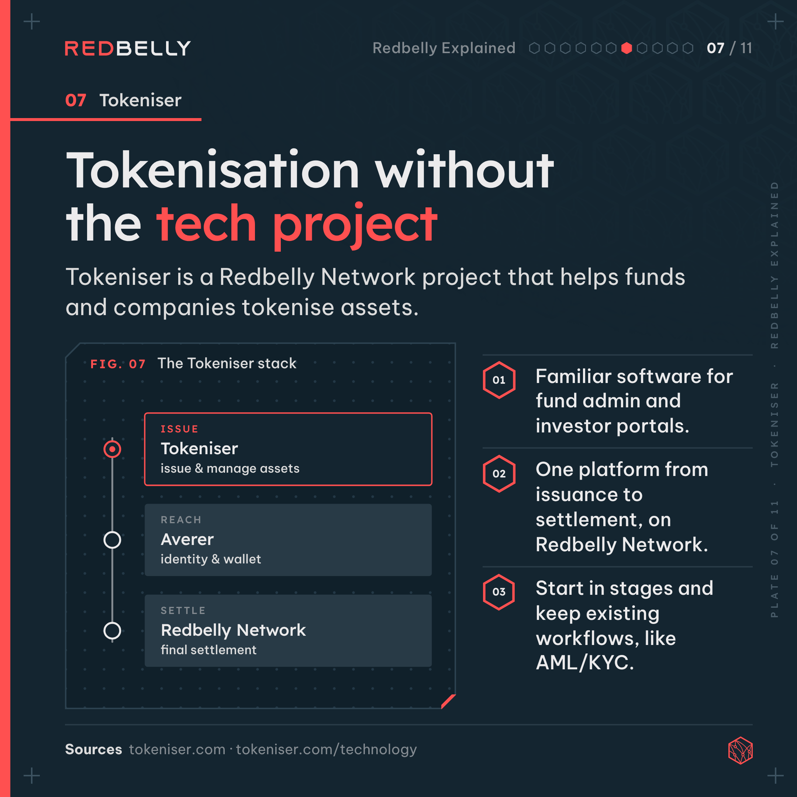</a><br>
      <sub><b>07</b> · TOKENISER</sub><br>
      <b>Tokenisation without the tech project</b><br>
      <sub><a href="png/07-tokeniser_16x9.png">16:9</a> · <a href="png/07-tokeniser_4x5.png">4:5</a> · <a href="png/07-tokeniser_1x1.png">1:1</a></sub>
    </td>
    <td width="33%" valign="top">
      <a href="png/08-compliance-aware-assets_1x1.png">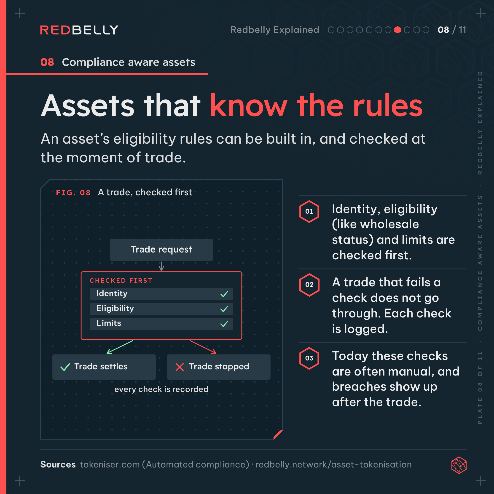</a><br>
      <sub><b>08</b> · COMPLIANCE AWARE ASSETS</sub><br>
      <b>Assets that know the rules</b><br>
      <sub><a href="png/08-compliance-aware-assets_16x9.png">16:9</a> · <a href="png/08-compliance-aware-assets_4x5.png">4:5</a> · <a href="png/08-compliance-aware-assets_1x1.png">1:1</a></sub>
    </td>
    <td width="33%" valign="top">
      <a href="png/09-identity-and-accountability_1x1.png">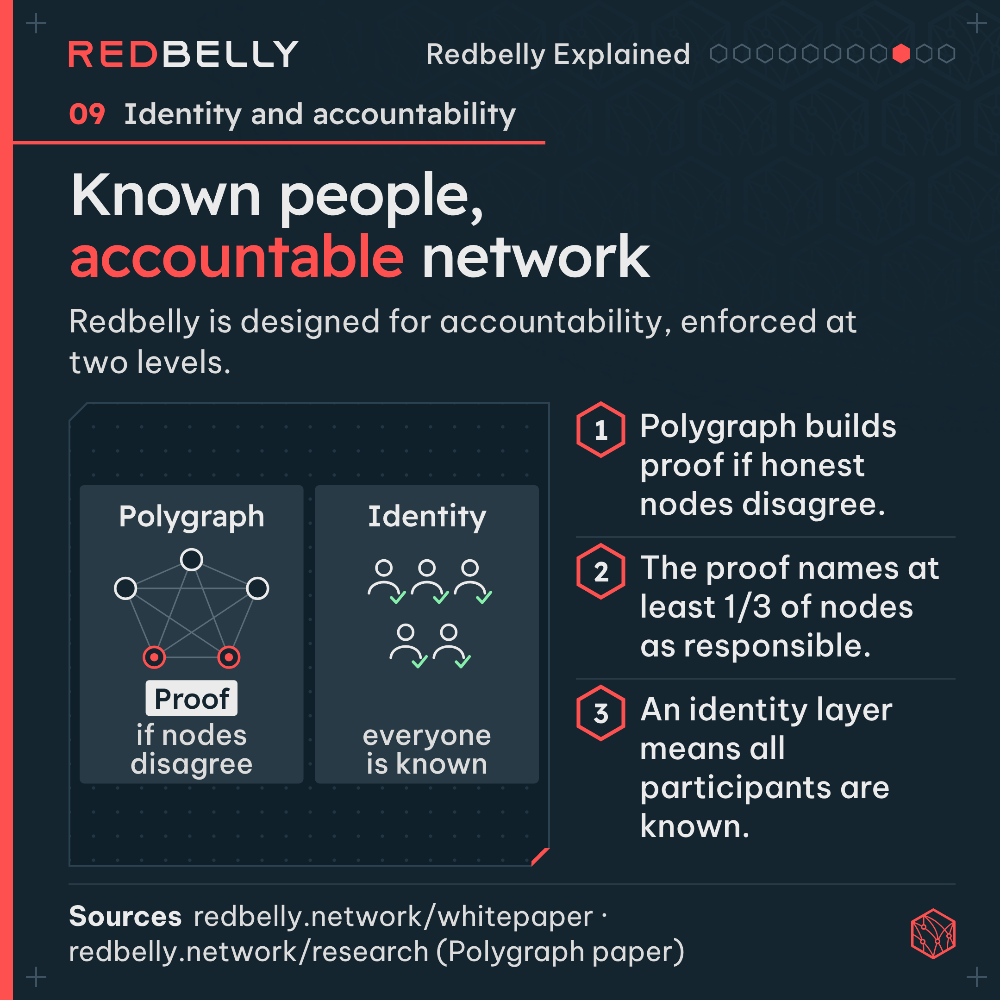</a><br>
      <sub><b>09</b> · IDENTITY AND ACCOUNTABILITY</sub><br>
      <b>Known people, accountable network</b><br>
      <sub><a href="png/09-identity-and-accountability_16x9.png">16:9</a> · <a href="png/09-identity-and-accountability_4x5.png">4:5</a> · <a href="png/09-identity-and-accountability_1x1.png">1:1</a></sub>
    </td>
  </tr>
  <tr>
    <td width="33%" valign="top">
      <a href="png/10-governance_1x1.png">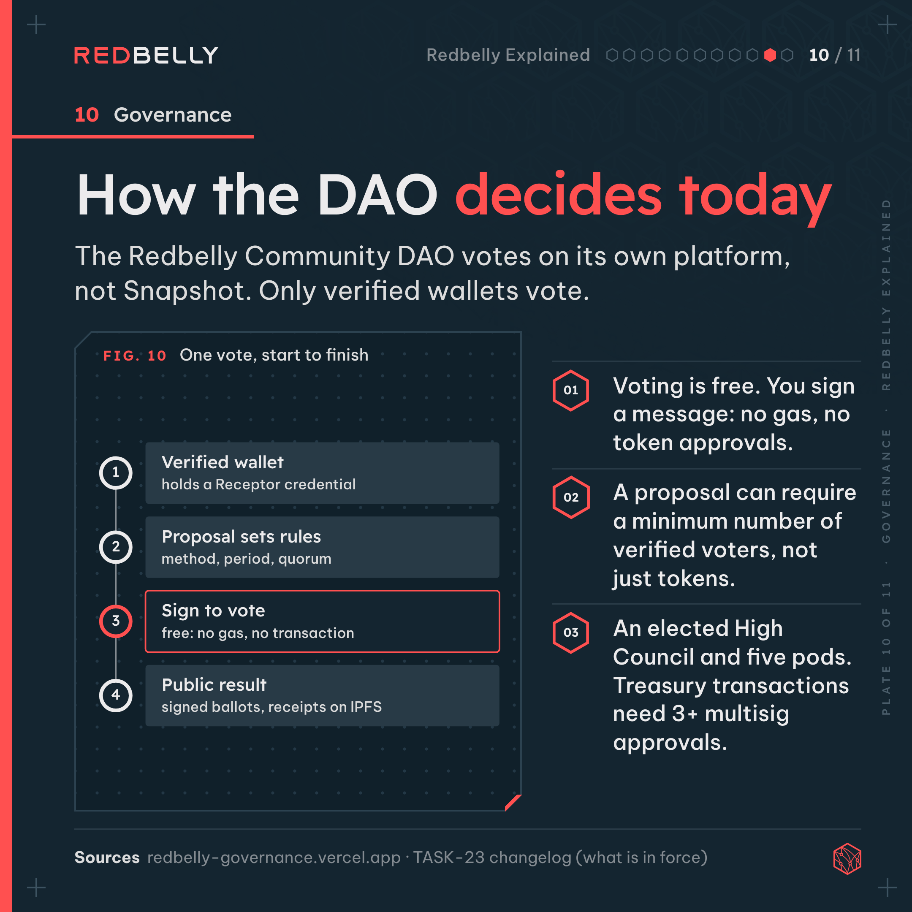</a><br>
      <sub><b>10</b> · GOVERNANCE</sub><br>
      <b>How the DAO decides today</b><br>
      <sub><a href="png/10-governance_16x9.png">16:9</a> · <a href="png/10-governance_4x5.png">4:5</a> · <a href="png/10-governance_1x1.png">1:1</a></sub>
    </td>
    <td width="33%" valign="top">
      <a href="png/11-project-acacia_1x1.png">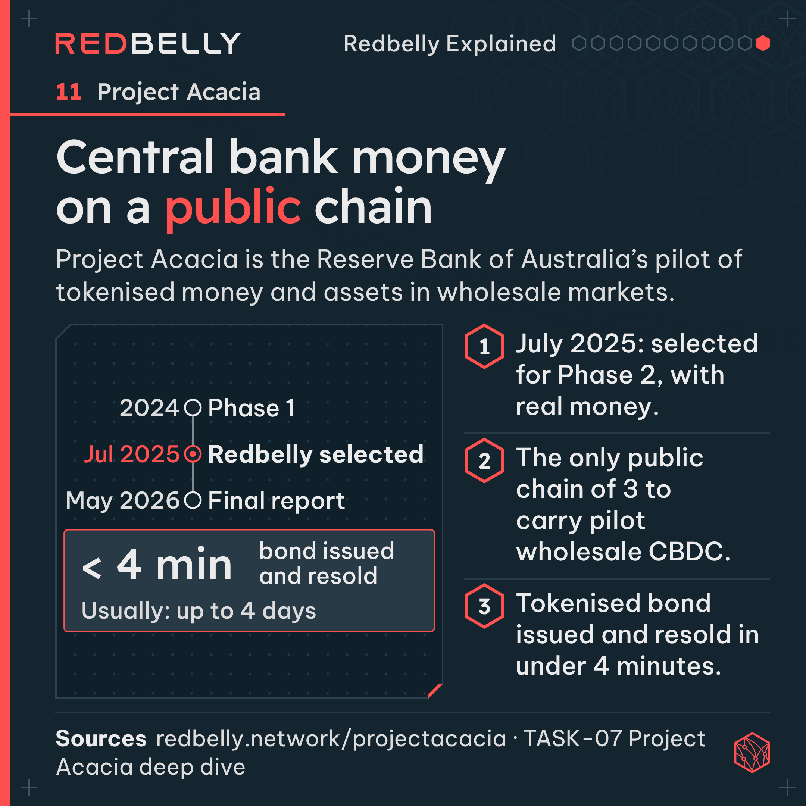</a><br>
      <sub><b>11</b> · PROJECT ACACIA</sub><br>
      <b>Central bank money on a public chain</b><br>
      <sub><a href="png/11-project-acacia_16x9.png">16:9</a> · <a href="png/11-project-acacia_4x5.png">4:5</a> · <a href="png/11-project-acacia_1x1.png">1:1</a></sub>
    </td>
    <td width="33%" valign="middle" align="center">
      <b>33 images</b><br>
      <sub>All in <a href="png/"><code>png/</code></a>, exported at 2× the minimum size.</sub><br><br>
      <sub>Facts and links for every plate:<br><a href="SOURCES.md"><code>SOURCES.md</code></a></sub>
    </td>
  </tr>
</table>

## Formats

Every plate is laid out three times, not cropped, so each format reads well on its own.

| Format | Size (px) | File suffix | Suited to |
|---|---|---|---|
| Landscape 16:9 | 3840 × 2160 | `*_16x9.png` | Slides, websites, X and YouTube |
| Portrait 4:5 | 2160 × 2700 | `*_4x5.png` | Instagram and LinkedIn feeds |
| Square 1:1 | 2160 × 2160 | `*_1x1.png` | Square feeds and thumbnails |

## View it locally

```bash
git clone https://github.com/joelbraker/redbelly-dao-infographics.git
cd redbelly-dao-infographics
python3 -m http.server 8000   # then open http://localhost:8000
```

Opening `index.html` straight from disk also works. The showcase site includes:

- **Live plates** with motion, a format switcher and a side-by-side view of all three formats
- **A honeycomb topic picker** and keyboard browsing with <kbd>←</kbd> <kbd>→</kbd>
- **A glossary** of every short form, which highlights the word in each image that uses it
- **The sources** for the plate on screen, plus a link to the full-size PNG

To view one plate on its own, open `plate.html` with these parameters:

| Parameter | Values | Example |
|---|---|---|
| `id` | `01` to `11` | `plate.html?id=04` |
| `f` | `169`, `45` or `11` (the format) | `plate.html?id=04&f=45` |
| `anim` | `1` turns motion on | `plate.html?id=04&f=45&anim=1` |

## Edit and re-export

All copy and diagrams live in plain JavaScript files, so you can edit them without a build step.

| To change | Edit |
|---|---|
| Titles, ledes, notes and source lines | [`src/content.js`](src/content.js). Wrap a word in `*asterisks*` to set it in brand red. |
| The 11 diagrams (hand-drawn SVG) | [`src/diagrams.js`](src/diagrams.js) |
| Layout, brand colours and motion | [`src/plate.css`](src/plate.css) |
| How a plate is assembled | [`src/plate.js`](src/plate.js) |
| The source map | [`src/sources.js`](src/sources.js) and [`SOURCES.md`](SOURCES.md) |
| Short forms and their full forms | [`src/glossary.js`](src/glossary.js) |

Then render new PNGs. You need [Node.js](https://nodejs.org) and [Playwright](https://playwright.dev):

```bash
npm install --no-save playwright
npx playwright install chromium

node export.js --scale=2 --out=png         # all 33 images
node export.js 04 10 --scale=2 --out=png   # only plates 04 and 10
```

The exporter prints each file it writes and flags `OVERFLOW` if any text runs outside its frame.

## Project structure

```
redbelly-dao-infographics/
├── index.html        Showcase site
├── plate.html        Renders one plate (?id=&f=&anim=)
├── export.js         Playwright exporter for the PNGs
├── SOURCES.md        Every fact mapped to its source
├── png/              The 33 final images
├── src/
│   ├── content.js    All copy
│   ├── diagrams.js   The 11 SVG diagrams
│   ├── plate.css     Layout for the three formats, colours and motion
│   ├── plate.js      Builds a plate from content and diagram
│   ├── sources.js    The full source map
│   ├── glossary.js   Short forms, full forms and where they appear
│   └── brand.js      Wordmark and isotype vectors
└── assets/
    ├── brand/        Logo vectors, favicons
    └── fonts/        Readex Pro, Be Vietnam Pro and their licences
```

## Sources

Every fact on the plates is mapped to the resource it comes from in [`SOURCES.md`](SOURCES.md), with all sources accessed on 27 October 2026.

> [!NOTE]
> **Governance (plate 10)** does not use Constitution v1.2 or the Snapshot rules. What is decided and in force comes from the TASK-23 changelog (sourced to 1 August 2026). How voting works today comes from the DAO voting platform, which takes priority wherever the changelog describes Snapshot voting.

<details>
<summary><b>Glossary: the 11 short forms used on the plates</b></summary>
<br>

| Short form | Full form | Plates |
|---|---|---|
| AML | Anti-Money Laundering | 05, 07 |
| CBDC | Central Bank Digital Currency | 11 |
| CSIRO | Commonwealth Scientific and Industrial Research Organisation | 01 |
| CTF | Counter-Terrorism Financing | 05 |
| DAO | Decentralised Autonomous Organisation | 10 |
| DBFT | Democratic Byzantine Fault Tolerance | 01, 03 |
| IPFS | InterPlanetary File System | 10 |
| KYC | Know Your Customer | 07 |
| Multisig | Multi-signature wallet | 10 |
| RBA | Reserve Bank of Australia | 11 |
| W3C | World Wide Web Consortium | 05 |

</details>

## Brand and typography

| Role | Value |
|---|---|
| Headers | [Readex Pro](https://github.com/ThomasJockin/readexpro) Medium, as the Redbelly brand page specifies |
| Running text | [Be Vietnam Pro](https://github.com/bettergui/BeVietnamPro), from the DAO brand tokens |
| Accent | `#FF5050` Redbelly red, the one accent colour |
| Ground | `#142530` ink · `#283A46` slate · `#ECEBEC` paper |

## Credits

- **Fonts.** Readex Pro and Be Vietnam Pro are licensed under the SIL Open Font License 1.1. The licence texts are in [`assets/fonts/`](assets/fonts).
- **Brand.** The Redbelly name, wordmark and isotype belong to Redbelly Network. They are used unaltered, as supplied in the Redbelly brand guidelines.
- **Content.** Facts come from public Redbelly resources, listed per plate in [`SOURCES.md`](SOURCES.md).
